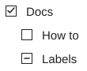

# Labels  

To move labels and their email assignments to another Thunderbird setup, use
**Preferences → Import/Export → Export labels and assignments**. After downloading the
same mail on the new computer, preview and restore the saved file. See the
[label backup guide](label-backup.md) for matching rules and missing messages.

See the [keyboard shortcut reference](keyboard-shortcuts.md) for the complete supported list.

Press **L** to search and apply labels; use Up/Down, Space to toggle and Escape to close.
In the list, changes apply to the conversations containing the selected messages. In the conversation reader, they apply to the whole resolved conversation, including sent replies. Numeric tag shortcuts, native tag menus, and the **×** removal button use that same conversation-wide scope. Clicking the chip opens matching mail across folders.

When a new message arrives, it inherits the union of the conversation’s existing labels, including labels on incoming and sent messages. This adds missing assignments without removing existing ones, changing read/unread state, or copying internal flags such as junk status. Installation does not relabel the mailbox in bulk. Existing partial assignments are preserved until a conversation-wide action or a new-message inheritance event updates them.

Automatic inheritance requires exact Message-ID/References links in available local account summaries; native subject-based thread grouping alone cannot authorize automatic label writes. Explicit conversation actions also use the native conversation scope. It does not fetch message bodies, search the server, or group messages by subject text. Unavailable local summaries can limit which messages are resolved.

**Inbox** is a system chip derived from actual Inbox membership. It is not a user label. Messages received into the Inbox show it automatically; archived messages do not. Removing its **×** archives the conversation.

A mixed checkbox means only some messages have the label; wait for conversation loading before applying changes, and check reported failures on cross-folder updates.

## Nested labels

Native tags named with `/` paths are displayed as expandable nested labels in the Labels sidebar. The `L` label picker uses a flat list of full paths. For example, `Work`, `Work/Projects` and `Work/Projects/Website` form a three-level tree. Enable the native Tags folder-pane mode to see this sidebar. Existing tag keys and message assignments are preserved, and message chips show the full path. Searching the picker matches full paths, independently of collapsed sidebar branches.

Select messages, press `L`, choose **Create new**, enter a name, enable **Nest label under**, and choose an existing parent. Creating a label applies it to the current selection or resolved conversation, including sent replies. Parent and child assignments are independent.

The hierarchy is derived from native tag names, not a separate skin database. Other clients see the full path when they support those same native tags; this feature does not add tag synchronization to a server/client that lacks it. Paths whose intermediate parents do not exist remain under the closest existing ancestor. Create those parent tags to show the missing levels. Native Manage Labels can edit individual full paths; renaming a parent does not automatically rename its descendants.

## Sidebar label menu

Hover a label in the Tags sidebar and click its three-dot button (also available on keyboard focus). The menu provides preset/custom label colors, Show/Hide in message-list rows, Edit, Remove label and Add sublabel.

Show/Hide is a local skin preference: hiding a chip preserves its native assignment and sidebar/picker entry. Editing a full path renames the label and its descendants while preserving their keys; conflicting paths are rejected before changes. Remove label asks for confirmation and keeps emails and sublabels. Add sublabel creates an unassigned native tag beneath the chosen parent, without applying it to the currently selected emails. Colors and names use Thunderbird's native tag service; other clients' behavior still depends on their tag synchronization support.

## Click a label to find matching mail

Click a label chip in the message list or conversation view to open its native Thunderbird tag view across folders. The tooltip identifies the label, and Enter/Space also activates a focused chip. This uses the exact tag key, including nested labels, and does not require global search indexing or Gmail query syntax. Existing quick-filter constraints are cleared for the results while preserving the sticky-filter preference. The conversation reader closes to reveal the matching list. The separate × button removes the tag from the conversation; it does not open the tag view.

Hiding chips keeps assignments; removing a label keeps emails and sublabels.
**Edit** renames descendants too, unlike Thunderbird’s native tag editor; **Add sublabel** creates a label without assigning it to selected mail.

## Label list visibility

Open a label’s three-dot menu and use **In label list**: **Show**, **Show if unread**, or **Hide**. The default is Show. Hidden labels, including unread-only labels with no unread messages, can be revealed with **More** at the bottom of Labels; **Less** collapses them again. Revealed labels retain their normal nested hierarchy.

A visible child keeps its parent path accessible. The currently selected label also stays visible until you navigate elsewhere, even if its unread count reaches zero. Choices are stored by stable native tag key, so renaming a label preserves its setting. These choices are independent of **In message list**, which controls chips beside email subjects.

Unread visibility uses Thunderbird’s existing native counts and change notifications. It does not scan mail or poll the server; label hierarchy updates are cached and notification bursts are batched.

## Edit multiple labels

Select several labels in the sidebar using Shift or Command/Ctrl, then open **⋮** on one of the selected labels. **Edit selected labels…** lets you choose a shared parent, color, sidebar visibility and message-list visibility. Fields default to **Keep current** so mixed values are preserved. The menu’s color and visibility actions also apply to the selected labels.

The editor previews all changed label paths before Apply. Selected parent/child pairs move together once, including descendants; color and visibility change only explicitly selected labels. Native tag keys and message assignments stay intact. Duplicate paths and moves into a selected subtree are rejected before writing; failed writes attempt to restore earlier values. Opening a menu on an unselected label edits only that label.

## Experimental local suggestions (development branch)

Available only on `codex/local-label-suggestions`, not part of a released version.
Select **1–500 messages** using the normal checkboxes in a folder or search result,
then click **✧ Suggest labels**. It sits beside the Settings gear normally and
moves to the right side of the selected-message action bar while checkboxes are selected. Multiple selected
messages in the same conversation produce one result. Larger selections show an
explicit limit message. Report text is selectable; use Cmd/Ctrl+A within the panel
to select the report and Cmd/Ctrl+C to copy it.

- **Dry run** reads local metadata and displays suggested labels, supporting
  evidence, and reasons for skipped conversations. It writes no preferences,
  message properties, labels, or assignments. Existing saved suggestions remain
  untouched.
- **Run · save suggestions** performs the same analysis, replaces the previous
  saved report, and draws dashed **Suggested: label** chips in the message list.
  These are *not* Thunderbird tags: they do not affect counts, searches, other
  clients, label inheritance, or synchronization.
- **Cancel analysis** stops processing without saving a partial report. Closing
  the panel, unloading the tab, or disabling the extension cancels pending work.
- **Clear saved suggestions** deletes only the separate experimental report.
  Real assignments are never modified by clearing suggestions.
- Each fresh result has **Confirm · assign label** and **Discard** buttons. Confirm
  is an explicit write action, including when reviewing dry-run results; Discard
  only removes the tentative proposal. Discarding a dry-run proposal writes no
  preferences. Future analyses may suggest a discarded label again.
- Nothing is checked by default. Check individual proposals, or explicitly choose
  **Select all suggestions**, then use **Confirm selected · assign labels** or
  **Discard selected**. Only checked, confirmable proposals are applied.
- Confirmation takes a fresh local header snapshot, checks current conversation
  membership, and rechecks live tags immediately before writing. Conversations
  that acquired any user label are skipped. It only adds an existing label to the
  exact References-linked members and physical copies, including Sent/Archives;
  it never expands via subject-based native grouping or removes other labels.
- Confirmed rows show the normal conversation-style colored label chip (including
  its dark-mode palette), rather than the dashed tentative chip, and have **Undo confirmation**. Undo removes only the keyword added
  to the exact physical messages in that confirmation, preserving other labels
  and legacy numeric tags. Undo is available while this report remains open and
  has not been replaced by another analysis. It does not remove labels inherited
  by messages that arrive after confirmation. Partial native failures are shown
  explicitly with an Undo action for any assignments that may have succeeded.
- Canceling a confirmation batch stops remaining assignments; already confirmed
  rows remain visible with Undo. The report states how many were confirmed.
  Historical saved snapshots can be discarded but must be reanalyzed before
  confirmation. Rechecking a large account can take time, so review several
  proposals together to share one fresh scan.

### What it learns and when it abstains

This first version uses **headers only**, including participants and subject
words. It does not read bodies, signatures, attachments, or quoted text, and
makes no network requests. No external service, model download, or second mail
index is used. Consequently, suggestions may be less accurate than a future
body-aware implementation. Evidence strengths are heuristics, not calibrated
probabilities.

It reads local physical folder summaries in the selected accounts, including
Sent, Archives, Trash and Junk, excluding virtual views. Accounts are isolated.
Message-ID and References links establish conversation membership; subjects and
shared senders alone never establish membership. Physical duplicates count as
one training conversation. Any existing user label on any linked local member
makes a selected conversation ineligible. The built-in Inbox chip is not a user
label and does not disqualify it.

Training uses already labeled, unselected conversations and **only existing
labels**. At least two distinct training conversations must support a label,
with shared subject evidence plus a participant or another subject term. Weak
matches and close alternatives are skipped. Label names are not invented.
Missing conversation identities, unavailable local folder summaries, or scan
limits cause conservative skips or stop the run rather than treating unreadable
mail as unlabeled. This cannot infer conversations or messages absent from local
headers.

### Limits, storage and invalidation

Analysis runs only when requested and yields between small batches. Each run
reads at most 100,000 headers. Training considers up to 2,500 labeled
conversations, with bounded feature storage; a conversation with over 20 labels
is not used for training. Features use at most the first 100 local messages and
64 distinct features per conversation. Selected conversations exceeding 1,000
local messages are skipped. Bounded subject/participant inputs and References
limits protect against oversized headers. The report indicates when training
limits were applied. Large accounts may still take time: the prototype builds a
fresh header snapshot on each run, even for a small selection.

Run stores one report in the profile preference
`extensions.thunderg.experimentalLabelSuggestions`, independently of Thunderbird
tag definitions and keywords. It includes label keys/names, message identifiers,
local folder/message keys, participant/subject-word evidence and a timestamp;
full message bodies and full subjects are not stored. Treat this as private local
profile data. It is not included in the label-assignment export.

Mail membership, labeling/header-evidence, or label-definition changes invalidate visible
chips; changes during analysis prevent saving a stale report. Recycled rows
re-render chips without starting another analysis. After restart, the saved
report can be reviewed in the panel as a snapshot, but chips are not restored
until a fresh Run checks eligibility. Saved proposals do not automatically apply
to newly arriving messages. Suggestions may be inspected again or cleared at
any time.

Explicit confirmation uses Thunderbird’s normal keyword-assignment mechanism,
so accepted labels may synchronize with the mail account as ordinary labels do.
The inference and rechecking stages remain local. Tentative proposals never
synchronize.
